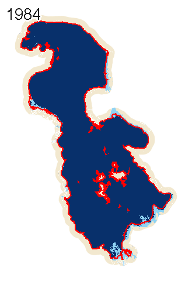
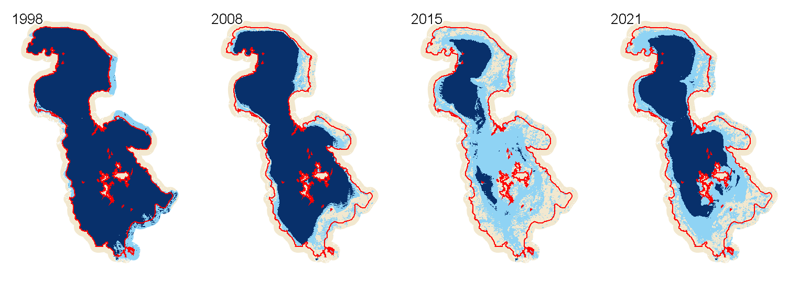

# GSW Lake Explorer

**Click any lake on Earth and watch how its surface water changed from 1984 to 2021.**

**[▶ Open the live app](https://risarezaei.projects.earthengine.app/view/gsw-lake-explorer)**: no sign-up, nothing to install. It runs in the browser on Google Earth Engine.

*Lake Urmia (Iran), JRC Global Surface Water yearly classes. Dark blue = permanent water, light blue = seasonal water, beige = land, red = HydroLAKES shoreline. Only the 27 years in which Landsat observed the whole lake are shown, so no frame has data gaps. Also as video: [`docs/timelapse.mp4`](docs/timelapse.mp4).*

## What it does

1. **Pick a lake:** click it on the map, or search a name (e.g. *Urmia*, *Chad*, *Aral*). The lake boundary comes from HydroLAKES (1.4 million lakes ≥ 10 ha), so there's no polygon to draw.
2. **Animation:** the yearly JRC Global Surface Water map of that lake, with the year on every frame. Only years in which Landsat observed the whole lake are played, so no frame has grey gaps. Play/Pause and *Next year* buttons.
3. **Chart:** permanent, seasonal and total water area (km²) per year. Years where > 5 % of the area lacks Landsat observations are hidden, because gaps would understate water.
4. **Summary:** mean permanent and total water area of the first decade (1984–1993) against the last decade (2012–2021).
5. **Share link:** the lake ID is written into the page URL (`#lake=142`), so a copied link opens the same lake.

Example (Lake Urmia): mean permanent water fell from **4,881 km² (1984–1993)** to **2,122 km² (2012–2021), −56.5 %**. Total water (permanent + seasonal) fell from 5,216 to 3,971 km² (−23.9 %): much of the former lake bed now floods only seasonally.

## Run it yourself

1. Open the [Earth Engine Code Editor](https://code.earthengine.google.com/) (free for non-commercial use).
2. Paste [`gsw_lake_explorer.js`](gsw_lake_explorer.js) into a new script and press **Run**.
3. Optional: **Apps → New App** publishes your own copy. Use a Cloud project without a billing account and it can't cost you anything.

## How it works

| Step | Earth Engine |
|---|---|
| Find the lake | `filterBounds(point)` on HydroLAKES, or `stringContains` on `Lake_name` |
| Adapt to lake size | analysis scale = max(30 m, 2·√area) and buffer = 50·√area, about 1 M pixels per year even for the Caspian |
| Animation | one `ui.Thumbnail` PNG per year, toggled every 0.5 s with `ui.util.setTimeout` (Earth Engine's animated-GIF thumbnails add a black band at the bottom once they have more than ~3 frames) |
| Areas | `ee.Image.pixelArea()` masked by `waterClass` = 2 / 3, `reduceRegion(sum)` per year |
| Data gaps | `waterClass` = 0 (no observation) is summed too; years above 5 % are dropped from the chart, and years above 1 % from the animation |
| Responsiveness | only `evaluate()` callbacks, never `getInfo()`; stale callbacks are ignored when you click quickly |

## Data

- **JRC Global Surface Water v1.4**, Yearly Water Classification History (Pekel et al., 2016, *Nature* 540, 418–422): [`JRC/GSW1_4/YearlyHistory`](https://developers.google.com/earth-engine/datasets/catalog/JRC_GSW1_4_YearlyHistory)
- **HydroLAKES v1.0** (Messager et al., 2016, *Nature Communications* 7, 13603), via the community catalog: `projects/sat-io/open-datasets/HydroLakes/lake_poly_v10`
- Year labels: the public `users/gena/packages:text` Earth Engine module

## Limits

- GSW is Landsat-based, so water under vegetation and very small lakes (< 1–2 pixels) are missed.
- Large lakes are analysed at a coarser scale (the scale is shown in the app).
- Years with heavy data gaps (common before 2000) are excluded from the chart, the summary and the animation.

## Author

Parisa Abbasalizadehrezaei · [risarezaei.github.io](https://risarezaei.github.io)

MIT licence.
